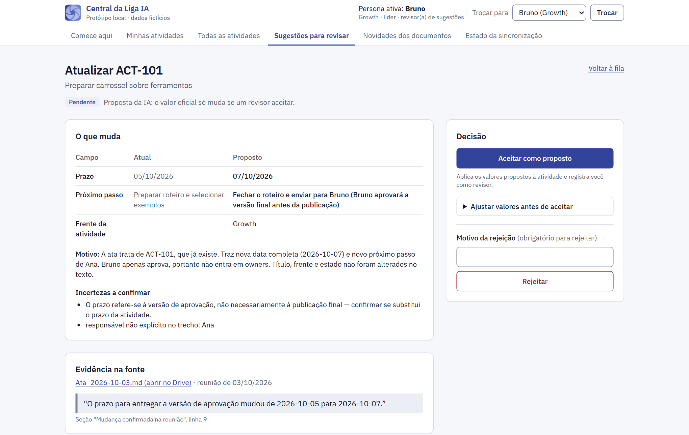
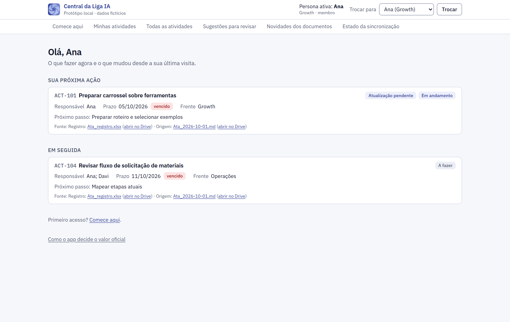

<p align="center">
  
</p>

<h1 align="center">Central de contexto e atividades</h1>

<p align="center">
  <strong>A ata da reunião vira atualização no painel, com evidência e revisão humana. A IA só propõe.</strong><br>
  Case técnico da Liga de IA da UFSCar · entregue em 04/10/2026
</p>

<p align="center">
  
  
  
  
  
</p>

Toda equipe tem o mesmo problema: a decisão sai na reunião, fica na ata, e a planilha de atividades continua desatualizada. Este app lê a pasta do Google Drive da Liga, entende o que mudou em cada ata nova e **propõe** a alteração no registro oficial, com o trecho literal da fonte. Nada muda até um revisor aceitar, e cada decisão fica no histórico.

<p align="center">
  
</p>

<details>
<summary>Mais uma tela: o painel pessoal de cada membro</summary>
<p align="center">
  
</p>
</details>

## O que eu construí

- **IA com humano no loop:** o modelo devolve um JSON validado (zod) com evidência literal por campo. Sugestão sem evidência é descartada, dado ausente fica marcado como incerto, e texto de ata com instruções para a IA não vira tarefa.
- **Integração Google:** OAuth 2.0 com escopo `drive.readonly` (o app nunca escreve no Drive), tokens cifrados em AES-256-GCM no banco local e sincronização a cada 60 s que lê `.md`, `.xlsx` e Google Docs.
- **Regra de precedência explícita:** a planilha apontada pelo `INDEX.md` é a fonte oficial na importação, e depois o banco SQLite (`node:sqlite`) passa a ser o registro, com autor, horário e valor anterior de cada mudança. Um arquivo mais novo com nome parecido não derruba o registro.
- **Custo medido, não estimado:** cada chamada grava tokens, latência e custo no banco. O custo medido ficou em **cerca de US$ 0,012 por ata**, com debounce para não reanalisar a cada edição e um provedor "gravado" para testar e demonstrar sem chave.
- **Qualidade:** 355 testes unitários (Vitest) e 8 testes E2E (Playwright) com Drive falso e IA gravada, sem rede. Os E2E cobrem navegação só por teclado, auditoria axe WCAG 2.x A/AA, celular a 375 px e persistência após reinício do servidor.
- **Documentação de engenharia:** PRD, arquitetura, decisões registradas (ADRs), análise do case e diário de bordo em [`docs/`](docs/).

| Se você quer... | Vá para |
|---|---|
| Entender o fluxo em 1 minuto | [Como funciona](#1-como-funciona-em-linguagem-simples) |
| Rodar sem conta Google nem chave de API | [Testes](#11-testes): `npm run test:e2e` sobe o app com Drive falso e IA gravada |
| Rodar com o seu Drive | [Instalação](#3-instalação-e-execução) e [Google Cloud](#4-google-cloud-e-pasta-do-drive-passo-a-passo) |
| Ver as decisões de arquitetura | [`docs/ARCHITECTURE.md`](docs/ARCHITECTURE.md) e [`docs/DECISIONS.md`](docs/DECISIONS.md) |

**Estado e próximos passos:** [`docs/PROGRESS.md`](docs/PROGRESS.md). Só dados fictícios; nenhuma credencial é versionada.

## Sumário

1. [Como funciona, em linguagem simples](#1-como-funciona-em-linguagem-simples)
2. [Fonte oficial das atividades e regra de precedência](#2-fonte-oficial-das-atividades-e-regra-de-precedência)
3. [Instalação e execução](#3-instalação-e-execução)
4. [Google Cloud e pasta do Drive, passo a passo](#4-google-cloud-e-pasta-do-drive-passo-a-passo)
5. [Sincronização](#5-sincronização)
6. [Formatos e escopo monitorado](#6-formatos-e-escopo-monitorado)
7. [IA: o que faz, o que não faz e quanto custa](#7-ia-o-que-faz-o-que-não-faz-e-quanto-custa)
8. [Limitações conhecidas](#8-limitações-conhecidas)
9. [Antes de usar dados reais](#9-antes-de-usar-dados-reais)
10. [Limpeza de cache, revogação e privacidade](#10-limpeza-de-cache-revogação-e-privacidade)
11. [Testes](#11-testes)
12. [Ferramentas de IA usadas](#12-ferramentas-de-ia-usadas)
13. [Documentação](#13-documentação)

---

## 1. Como funciona, em linguagem simples

```text
Google Drive (só leitura) ──► sincronização a cada 60 s ──► leitura dos arquivos (.md, .xlsx, Google Docs)
                                                                   │
                       planilha de atividades (indicada pelo INDEX.md) ──► importação inicial ──┐
                                                                   │                            ▼
                       atas novas ──► IA propõe mudanças com evidência ──► fila de sugestões ──► revisor aceita,
                                                                                                 ajusta ou rejeita
                                                                                                        │
                                                    banco local (SQLite) = registro oficial + histórico ◄┘
```

- O **Drive só é lido**. O app pede apenas o escopo `drive.readonly` e nunca escreve nele.
- Depois da importação inicial, o **registro oficial das atividades é o banco local** (um arquivo SQLite em `data/`). Cada mudança fica no histórico, com autor, horário, valor antes e depois e a fonte.
- A **IA só propõe**. Uma sugestão não altera nada até um revisor aceitar. Datas, responsáveis e estados vêm dos registros, não do texto livre do modelo.
- Tudo roda **na sua máquina**, em `http://localhost:3000`. Não há login: a pessoa é escolhida por uma **persona** no topo da página (protótipo).

Seis áreas, sempre visíveis nas abas do topo: *Comece aqui*, *Minhas atividades*, *Todas as atividades*, *Sugestões para revisar*, *Novidades dos documentos* e *Estado da sincronização*.

## 2. Fonte oficial das atividades e regra de precedência

**Decisão (DEC-018, DEC-021):** a fonte das atividades é **a planilha que o `INDEX.md` aponta** como fonte das atividades (arquivo e aba). O app não escolhe "a planilha mais recente", nem pelo nome nem pela data. Se o índice não aponta com certeza (nenhum arquivo, ou mais de um com o mesmo nome), o app **mostra a pendência e não importa nada**. Planilhas parecidas aparecem como "sem autoridade / possível conflito", com os motivos.

Se o índice cita `X.xlsx` e o Drive guardou o arquivo como `X.xlsm` (acontece ao editar pelo Planilhas Google), vale a **única** planilha de mesmo nome-base. O app só lê células; nunca executa macros.

**Precedência do valor oficial** (a mesma regra aparece na tela *Como o app decide*):

1. **Decisão humana registrada no app.** Uma edição manual, ou uma sugestão aceita ou ajustada por um revisor, define o valor oficial atual. Toda decisão fica no histórico.
2. **Importação inicial do registro apontado pelo índice.** É o valor oficial de partida.
3. **Proposta de ata nova, ainda pendente.** Não muda o valor oficial. Só gera o aviso "atualização pendente" até um revisor decidir.
4. **Documentos de direção** (índice, estado atual, guia). Dão contexto e orientação, não valores de atividade.
5. **Documentos superados, rascunhos e planilhas sem autoridade.** Nunca anulam um registro oficial; ficam como histórico ou marcados "sem autoridade".
6. **Duas fontes ativas que discordam, sem decisão humana.** Geram um conflito visível, com links para as duas. O valor oficial não muda até alguém decidir.

## 3. Instalação e execução

**Requisitos:** Node.js **22.13 ou superior** (recomendado: 24 LTS) e npm. Nenhum banco para instalar: o SQLite vem embutido no Node.

```bash
git clone https://github.com/LenziAI-DEV/liga-ia-central-atividades.git
cd liga-ia-central-atividades
npm install
npm run setup      # cria o .env.local e gera a chave de cifra dos tokens
# preencha o .env.local (seção 4)
npm run app        # build + servidor em http://localhost:3000
```

- O servidor escuta **só em `127.0.0.1`** e recusa qualquer outro host (403). Abra por **`http://localhost:3000`** (abrir por `127.0.0.1` redireciona para `localhost`, por causa do cookie do OAuth).
- Em desenvolvimento: `npm run dev`.
- O npm 11 pode imprimir um aviso `allow-scripts` sobre `unrs-resolver` (usado pelas ferramentas de lint e teste). É inofensivo: tudo funciona sem aprovar o script. Testado numa instalação limpa (`npm install`, `npm run setup`, 354 testes, typecheck, lint e 8 testes E2E).
- Variáveis em `.env.example`, com os padrões entre parênteses:

| Variável | Para quê |
|---|---|
| `GOOGLE_CLIENT_ID`, `GOOGLE_CLIENT_SECRET` | Cliente OAuth (seção 4). Obrigatórias no modo Google |
| `DRIVE_TEST_FOLDER_ID` | Pasta raiz monitorada (trecho depois de `/folders/` na URL) |
| `APP_ENCRYPTION_KEY` | Chave AES-256 que cifra os tokens no banco. Gerada pelo `npm run setup`; **não troque depois de conectar** |
| `ANTHROPIC_API_KEY` | Chave da IA (opcional). Sem ela, a análise de atas fica **desligada** e o resto funciona |
| `ANTHROPIC_MODEL` (`claude-sonnet-5-5`) | Modelo da análise |
| `SYNC_INTERVAL_SECONDS` (60) | Intervalo da sincronização, de 30 a 600 |
| `AI_DEBOUNCE_SECONDS` (120) | Espera a ata ficar estável antes de gastar uma chamada. **Para uma demo ao vivo, use 0 a 10** |
| `APP_BASE_URL`, `GOOGLE_REDIRECT_URI` | Só se mudar a porta (`http://localhost:3000`) |
| `DATABASE_PATH` (`data/app.db`), `LOG_LEVEL` (`info`), `INDEX_FILE_NAME` (`INDEX.md`) | Opcionais |

**Modo sem Google (só para explorar a interface):** `DRIVE_MODE=fake` e `AI_PROVIDER=recorded` usam um Drive simulado com os dados fictícios do repositório e respostas de IA gravadas. Não demonstra o OAuth nem a IA real. É o modo usado nos testes E2E.

## 4. Google Cloud e pasta do Drive, passo a passo

Cada pessoa usa **as próprias credenciais e a própria pasta**. Nada disso vai para o repositório.

1. **Pasta no Drive.** Crie uma pasta (ex.: `LIA case teste`) e envie o conteúdo de [`dados_ficticios/01_CARGA_INICIAL`](dados_ficticios/01_CARGA_INICIAL), preservando os nomes. Os arquivos de `02_ADICIONAR_DEPOIS_DA_CARGA` e `03_CONFLITO` servem para testar depois (veja `dados_ficticios/LEIA_ME_PRIMEIRO.md` e [`docs/DEMO.md`](docs/DEMO.md)). Copie o ID da pasta da URL (`.../folders/<ID>`) para `DRIVE_TEST_FOLDER_ID`.
2. **Projeto.** Em [console.cloud.google.com](https://console.cloud.google.com), crie um projeto.
3. **API.** *APIs e serviços › Biblioteca* › ative a **Google Drive API**.
4. **Tela de consentimento.** *APIs e serviços › Tela de permissão OAuth*: tipo **Externo**, em modo **Teste**. Em *Usuários de teste*, adicione a conta Google que será conectada. Escopo: só `.../auth/drive.readonly`.
5. **Credencial.** *Credenciais › Criar credenciais › ID do cliente OAuth*, tipo **Aplicativo da Web**. Em *URIs de redirecionamento autorizados*, coloque exatamente `http://localhost:3000/api/auth/google/callback`.
6. Copie o **ID do cliente** e a **chave secreta** para `GOOGLE_CLIENT_ID` e `GOOGLE_CLIENT_SECRET` no `.env.local`, e reinicie o app.
7. Abra **Estado da sincronização › Conectar conta Google**. A tela "O Google não verificou este app" é esperada em modo de teste: *Avançado › continuar*. Conceda o acesso de **somente leitura**.

**Atenção:** em modo de teste, a autorização do Google **expira em 7 dias**. Se a sincronização pedir "reautorização necessária", clique em *Reconectar conta Google*. **Reautorize no dia da demonstração.**

## 5. Sincronização

- **Intervalo:** a cada 60 s (configurável), mais o botão **Sincronizar agora**. Um arquivo novo ou editado é detectado e processado em **menos de 1 minuto** (medido com o Drive real; meta da banca: até 5 min).
- **Idempotente:** sem mudança, nada é baixado nem duplicado. A mesma ata analisada duas vezes não gera sugestões repetidas.
- **Arquivo editado:** continua sendo **uma só fonte**, com uma nova versão processada. As sugestões pendentes da versão antiga ficam "fonte alterada — revisar" e são substituídas pela nova análise.
- **Arquivo renomeado ou movido dentro da pasta:** mesma fonte, nome e caminho atualizados, histórico preservado.
- **Arquivo removido, na lixeira ou sem acesso:** a fonte vira **"indisponível desde …"**, o conteúdo em cache é apagado e as atividades **não** são apagadas; a referência mostra "fonte indisponível". Arquivo movido para fora da pasta aparece como "fora da pasta".
- **Falhas:** se o Drive não responde, o ciclo falha **sem alterar o que já estava confirmado**. O intervalo dobra a cada falha seguida (teto de 5 min), uma faixa avisa "dados potencialmente desatualizados" desde quando, e tudo volta ao normal sozinho quando a conexão volta. Um arquivo com falha não impede os outros. Conexão perdida ou revogada pede reautorização, sem apagar nada.
- **Resumo do que mudou** (*Novidades dos documentos*): arquivos novos, alterados e indisponíveis desde a última visita.

## 6. Formatos e escopo monitorado

**Lidos:** Markdown (`.md`, preservando títulos e metadados `chave: valor`), planilhas **`.xlsx` e `.xlsm`** (abas, células e datas) e **Google Docs nativos** (exportados como texto).

**Não lidos** (aparecem como "formato ainda não processado", com o motivo e sem inventar conteúdo): `.docx` (converta para Documento Google), PDF, imagens, vídeo e Planilha Google nativa (baixe como `.xlsx` e envie de volta). PDF com texto é um diferencial opcional **não implementado**.

**Escopo:** só a pasta configurada e as suas subpastas. Nada fora dela é lido. Atalhos não são seguidos, porque o destino pode estar fora da pasta.

## 7. IA: o que faz, o que não faz e quanto custa

- **Modelo:** `claude-sonnet-5-5`, esforço `medium`, saída estruturada validada por esquema. **Sem ferramentas:** o modelo só devolve um objeto de sugestões.
- **O que faz:** lê uma ata e propõe criar ou atualizar atividades. Cada campo proposto exige **evidência literal** (trecho que existe na fonte, conferido por código). O que o texto não afirma fica vazio e marcado como incerto ("até sexta" não vira data; dono desconhecido não vira dono).
- **O que não faz:** não altera nada oficial; não classifica a autoridade de documentos (isso é determinístico); não recebe tokens nem credenciais. Instruções escondidas dentro de um documento ("ignore as regras…") não são seguidas; saídas inválidas são descartadas.
- **Resumo por documento** (*Novidades*): único texto gerado por IA fora das sugestões, sempre rotulado "gerado por IA — confira na fonte".
- **Custo medido** (7 documentos reais, `effort: medium`): **US$ 0,0086 a 0,0134 por ata, em média cerca de US$ 0,012**, com 2.800 a 3.100 tokens de entrada e 290 a 770 de saída, em 4 a 7 s. A carga das 3 atas do pacote custa cerca de **US$ 0,035**. O custo só ocorre quando uma ata é nova ou foi editada; a espera de estabilidade (`AI_DEBOUNCE_SECONDS`) evita pagar por edição contínua, e há um **teto de 100 chamadas em 24 h**. Os valores de cada chamada ficam na tabela local `ai_calls` (só tokens, custo e status; nunca o conteúdo).
- **Sem chave:** a análise fica "desligada", com aviso; o painel, o histórico e a edição manual seguem funcionando.

## 8. Limitações conhecidas

- **Protótipo local, sem autenticação:** a "persona" é uma escolha de interface, não segurança. O papel de revisor é conferido no servidor, mas qualquer pessoa na máquina pode trocar de persona. Não exponha a porta em rede.
- **Visibilidade (F9.6, F13.5):** todas as fontes da pasta são visíveis a todas as personas. O resumo "para você" não filtra documentos por permissão. Em uso real, seria preciso respeitar as permissões do Drive por pessoa.
- **Uma pasta, uma conta Google** por instalação.
- **Planilha Google nativa** não é lida (seção 6). **Sem PDF.**
- **Qualidade da IA:** a evidência é verificada, mas a *interpretação* pode errar; por isso toda sugestão passa por um revisor. Atas com formato muito diferente do pacote podem render menos propostas.
- **A autorização do Google expira em 7 dias** (modo de teste).
- **Acessibilidade:** axe sem violações em 9 telas, teclado, 375 px e escala de cinza testados automaticamente. A conferência manual com leitor de tela não foi feita.
- **Sem modo escuro** e só em português.

## 9. Antes de usar dados reais

O app foi feito e testado só com dados fictícios. Antes de apontar para documentos reais da Liga:

1. **Revise as permissões:** quem usa a instalação enxerga todos os arquivos da pasta (limitação acima). Use só uma pasta cujo conteúdo todos possam ver.
2. **Envio à IA:** o texto das atas vai para a API da Anthropic. Confirme que isso é permitido para os documentos reais e use uma chave sua, guardada só no `.env.local`.
3. **Autenticação:** adicione login e vincule a persona à conta antes de qualquer uso compartilhado.
4. **Acesso ao Drive:** mantenha somente leitura e restrito à pasta; **não use service account**. Em modo de teste do Google, só os usuários de teste conseguem conectar.
5. **Backup e limpeza:** o banco local guarda o histórico oficial (seção 10). Faça cópia de `data/app.db` e decida por quanto tempo guardar o cache.
6. **Nunca** versione `.env.local`, `data/`, capturas de tela ou vídeos com tokens, chaves ou dados reais.

## 10. Limpeza de cache, revogação e privacidade

- **Guardamos o mínimo:** o texto extraído dos arquivos é um **cache** para análise e evidência. Tokens do Google ficam **cifrados (AES-256-GCM)** no banco local. Logs vão para `data/logs/`, sem segredos.
- **Invalidação automática:** quando uma fonte é excluída, vai para a lixeira, sai da pasta ou perde o acesso, o app **apaga o cache de conteúdo dela** e a marca "indisponível". Se a pasta configurada for trocada, o que era da pasta antiga fica "fora da pasta" e o cache é apagado.
- **Apagar tudo o que é local:** `npm run data:clear` (pede confirmação; `-- --yes` para não interativo). Remove banco, cache, tokens cifrados e logs. **Não afeta o Drive.** Na próxima execução, o app recria o banco e pede nova conexão.
- **Revogar o acesso ao Drive:** em *Estado da sincronização*, **Desconectar** (revoga no Google e apaga os tokens locais). Se não houver rede, a tela avisa e orienta: *Conta Google › Segurança › Suas conexões com apps e serviços de terceiros › remover*.

## 11. Testes

```bash
npm test               # unitários e de integração (Vitest): 354 testes (+ 7 de gravação pulados)
npm run typecheck && npm run lint
npm run test:e2e       # Playwright + axe, 8 testes, ~11 s (gera um build próprio em .next-e2e)
npm run test:coverage  # cobertura de src/server e src/lib
npm run ai:record      # regrava as respostas da IA usadas nos testes (gasta a API; precisa de chave)
```

O E2E roda contra o build de produção com Drive falso e IA gravada, sem rede. Os casos de validação (conflito, dado ausente, arquivo novo, injeção, etc.) com entrada, resultado esperado e observado estão em [`docs/VALIDACAO.md`](docs/VALIDACAO.md).

## 12. Ferramentas de IA usadas

**Para construir:** [Claude Code](https://claude.com/claude-code) com modelos Claude (Sonnet 5.5 como padrão; Opus quando justificado), com o plugin ECC (agentes de revisão de código, de segurança e de React, e rotinas de verificação). As regras de uso (modelo, esforço, subagentes, revisão) estão em [`docs/AI_EXECUTION_POLICY.md`](docs/AI_EXECUTION_POLICY.md). Toda mudança passou por testes automatizados e revisão proporcional ao risco; o que a IA errou e como corrigi está no diário de bordo.

**Dentro do produto:** Claude Sonnet 5.5 via API da Anthropic, só para propor sugestões e resumir documentos (seção 7). Nada mais usa IA.

## 13. Documentação

| Documento | Conteúdo |
|---|---|
| [`docs/PRD.md`](docs/PRD.md) | Requisitos, critérios de aceitação e decisões de produto |
| [`docs/ARCHITECTURE.md`](docs/ARCHITECTURE.md) | Arquitetura, alternativas avaliadas e riscos |
| [`docs/DECISIONS.md`](docs/DECISIONS.md) | Decisões técnicas e seus motivos |
| [`docs/DESIGN_SYSTEM.md`](docs/DESIGN_SYSTEM.md) | Cores, tipografia, componentes e acessibilidade |
| [`docs/VALIDACAO.md`](docs/VALIDACAO.md) | Registro de validação (entrada, esperado, observado, correções) |
| [`docs/DIARIO_DE_BORDO.md`](docs/DIARIO_DE_BORDO.md) | Diário de bordo do desenvolvimento |
| [`docs/DEMO.md`](docs/DEMO.md) | Roteiro da demonstração e checklist pré-demo |
| [`docs/PROGRESS.md`](docs/PROGRESS.md) | Estado atual e próximos passos |
| [`docs/CASE_ANALYSIS.md`](docs/CASE_ANALYSIS.md) | Análise dos documentos do case |
